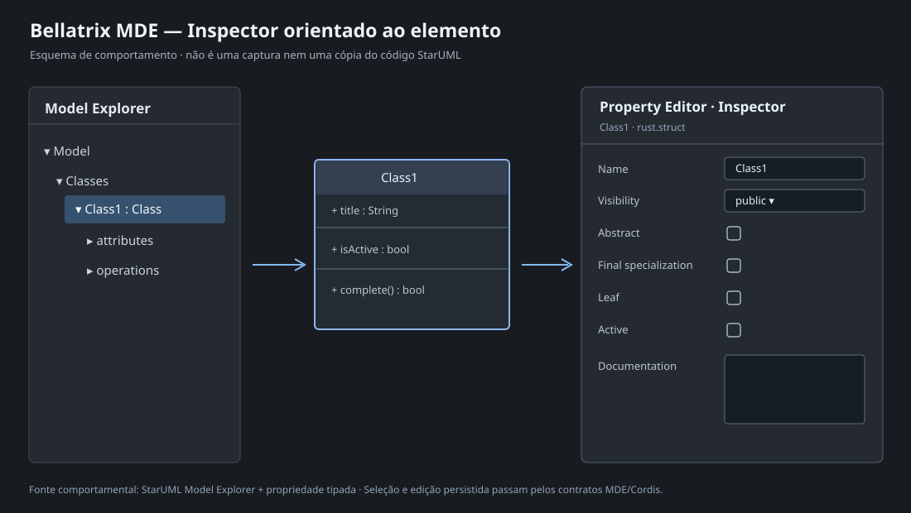

# Inspector MDE: contrato de objeto, metamodelo e edição de propriedades

**Estado:** especificação normativa mínima da Engine-MDE. A projeção tipada e a primeira implementação de edição escalar foram publicadas no fork; não considerar homologada até passar nos testes Rust e na validação UX no Zed. O desenho de referência vem das capturas StarUML compartilhadas pelo mantenedor, do protótipo React Bellatrix e do código de referência StarUML. As ilustrações abaixo foram produzidas para documentar o contrato, sem copiar código proprietário.




## 1. Definição obrigatória

**Inspector é uma capacidade do domínio MDE: inspeção das propriedades e operações do elemento selecionado.** O Property Editor é sua representação visual editável. O Inspector **não** é um formulário fixo de nome e caminho de projeto.

| Responsabilidade | Contrato | Onde aparece |
| --- | --- | --- |
| Model Explorer | Objetos semânticos + estrutura de propriedade/contensão `owns` | Painel lateral |
| Inspector | Projeção tipada do objeto atualmente selecionado | Contrato da engine, sem GPUI |
| Property Editor | Campos de texto, booleano, enum, número, documentação, referências e coleções | Abaixo do Model Explorer |
| Project Panel | Worktrees, arquivos e diretórios | Painel nativo do Zed; não duplicar |
| Project persistence | Save/Load, ID, revisão, snapshots e eventos | Plataforma Bellatrix/Cordis |
| Canvas | Views, posição, geometria e seleção | `workspace::Item` do Zed |

A seleção de uma classe no Canvas ou no Model Explorer mostra **propriedades da classe**, não apenas seu nome. A seleção de um atributo/operação mostra um conjunto diferente de propriedades. A UI é uma projeção dinâmica do tipo do objeto.

## 2. Metamodelo e composição em Rust

O elemento-base existente é `bellatrix_mde_model::Element`:

```rust
pub struct Element {
    pub id: String,
    pub kind: String,
    pub name: String,
    pub label: Option<String>,
    pub description: Option<String>,
    pub properties: BTreeMap<String, serde_json::Value>,
    pub annotations: Vec<Annotation>,
    pub implementations: Vec<Implementation>,
    pub content: Option<FileContent>,
}
```

Os tipos especializados são **descritores compostos**: identidade + atributos básicos + atributos específicos. Não é necessário simular herança clássica em Rust. O modelo mantém identidade única; `kind` determina o schema. Referências a propriedades complexas e membros devem preservar identidades, não copiar estruturas em textos na UI.

StarUML confirma a abordagem de metamodelo: `extensions/essential/uml/metamodel.json` define `UMLModelElement` (superclasse de metamodelo com stereotype e visibility); `UMLClassifier` declara coleções `attributes` e `operations`, `isAbstract`, `isFinalSpecialization` e `isLeaf`; `UMLClass` acrescenta `isActive`. `UMLAttribute` e `UMLOperation` têm seus próprios atributos. A implementação em Rust é independente do código StarUML.

### Esquema mínimo por tipo

| Origem | Propriedades editáveis | Editor/observações |
| --- | --- | --- |
| Base `Element` | `name`, `label`, `description` | Texto; documentação multiline; `id` e `kind` só leitura |
| Classifier | `stereotype`, `visibility`, `isAbstract`, `isLeaf` | Texto/referência, enum, booleans |
| Class | `isFinalSpecialization`, `isActive` | Booleans específicos de Class |
| Attribute | `declaration`, `type`, `defaultValue`, `visibility`, `isStatic`, `isReadOnly` | Propriedades específicas do atributo |
| Operation | `signature`, `visibility`, `isStatic`, `isAbstract`, `isQuery` | Propriedades específicas da operação |
| Extensões | `Element.properties` adicionais | Mostrar valores primitivos; objetos/listas exigem editor especializado |
| Membros | `attributes`, `operations` | Coleções de **Element IDs** ligadas por `Relation.kind = "owns"` |

Os defaults tipados não alteram o documento ao abrir o Inspector. Editar um campo grava a propriedade explícita no estado persistente. O tipo é dinâmico/aberto a novas engines, mas **nenhuma propriedade pode ser editada sem schema e validação**.

### Projeto de API já publicado

- `crates/bellatrix_mde_modeling/src/inspector.rs`: `InspectorProperty`, `PropertyEditor`, `ElementInspector`, `inspect_element(section, id)`, `set_inspected_property(section, id, path, value)`.
- `crates/bellatrix_mde_cordis/src/set_property.rs`: `ModelingSetPropertyRequested`, evento `bellatrix.mde.set-property.v1`, validação e `ProjectReplace` com revisão esperada.
- `crates/bellatrix_mde_workbench/src/property_editor.rs`: Zed GPUI consome os descritores e escolhe controles; a edição usa `MdeUiBridge` e não modifica `ModelingSection` diretamente.

## 3. Contrato de seleção e persistência

```text
Canvas ou Model Explorer seleciona Element ID
    → MDE apresenta ElementInspector (base + propriedades do tipo + membros)
    → Property Editor constrói os controles adequados
    → usuário modifica uma propriedade
    → ModelingSetPropertyRequested {
         project_id, element_id, path, value, expected_revision
       }
    → Cordis Event / schema / Graph::validate
    → ProjectService::ProjectReplace (controle concorrente de revisão)
    → ProjectStateChangedEvent
    → Canvas + Model Explorer + Property Editor atualizam do novo snapshot
```

Se o tipo da propriedade for booleano, salvar `true/false`; não escrever `"true"` em string. Se for enum, validar opções. Proibir alterações genéricas de `id`, `kind` ou relações por JSON path. Ações de criar/deletar membros são comandos de domínio separados. Operações da classe são elementos relacionados (ex.: `rust.function`); clicar no membro abre seu Inspector.

**Espaço-temporal:** Zed controla a UI, Dock, foco e estado efêmero. Cordis controla composição e eventos de backend; a UI não inventa barramento. Fechar a janela ou descarregar uma engine não remove documentos persistidos.

## 4. UX — mínimo reproduzível

A UI acompanha o tema ativo do Zed. A árvore do Model Explorer contém somente objetos do domínio; a árvore de arquivos do Zed permanece no Project Panel. O Inspector ocupa o **Property Editor**, separado do botão de salvar projeto. Ao mudar a seleção, o esquema inteiro muda; textos em edição não são substituídos a cada render.

O resultado visual mínimo deve reproduzir o comportamento observado nas referências: selecionar `Class1` na árvore ou no Canvas mostra, no painel de propriedades, `name`, `stereotype`, `visibility`, `isAbstract`, `isFinalSpecialization`, `isLeaf`, `isActive`, `Documentation`. Selecionar Attribute/Operation muda a especialização. A classe pode mostrar Attributes/Operations e permitir navegar a seus IDs.

### Critérios de aceitação verificáveis

1. Class → propriedades comuns + especializadas corretas, incluindo visibilidade como enum e flags como booleans.
2. Attribute/Operation → propriedades específicas; nenhuma flag exclusiva de Class deve aparecer.
3. Editar `name`, `label`, documentação, enum e bool → salvar, reabrir e preservar valor e tipo.
4. Edição concorrente ou revisão obsoleta → rejeição, com feedback; não sobrescrever silenciosamente.
5. `id` e `kind` → leitura apenas; referências e listas não podem ser alteradas com texto JSON arbitrário.
6. Attributes/Operations → navegação para o elemento do membro; podem ter seu próprio Inspector.
7. Projeto sem seleção → instrução de seleção, não propriedades de objeto falso.
8. Theme Zed claro/escuro/personalizado → controles nativos herdam cores e foco do tema ativo.
9. `Project file path` não pode ser apresentado como propriedade de uma classe.
10. **Gates pendentes:** documentação multiline verdadeira, referência tipada e list editor com add/remove/reorder, persistência de estado do Inspector e testes visuais nativos. Não declarar esses itens prontos antes de implementar.

## 5. Referências e imagens

- Capturas StarUML anexadas pelo mantenedor nesta conversa, incluindo o objeto selecionado e seu editor de propriedades. O conjunto original deve ser retido como referência visual de aceitação.
- Arquivo de referência fornecido: `starUml.zip`, `src/views/property-editor-view.js`, `src/views/model-explorer-view.js`, templates `src/static/html-contents/property-editor-view-item-*.html` e `extensions/essential/uml/metamodel.json`.
- Design React Bellatrix: [código e protótipo](https://github.com/konirasec-a11y/bellatrix/tree/main/docs/design), [captura dark v3](https://github.com/konirasec-a11y/bellatrix/blob/main/docs/design/preview/v3-dark.png).
- Diagramas originais **versionados com esta especificação**: [seleção e Inspector](inspector-reference.svg) e [contrato Inspector/Cordis](inspector-contract.svg).

**Aviso:** as imagens do StarUML são referência de comportamento e UX, não autorização para copiar assets ou código proprietário. As duas ilustrações SVG neste diretório são próprias e documentam essa referência.
