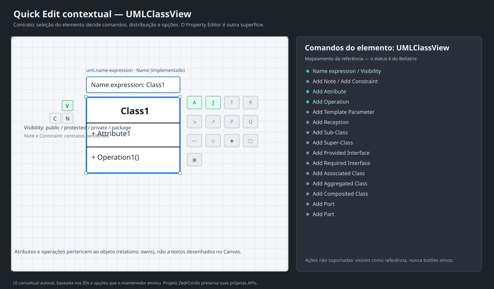

# Quick Edit contextual da Engine-MDE — contrato prioritário

> **Normativo:** a prioridade é **o conjunto de opções que cada tipo de elemento fornece**, como no Quick Edit do StarUML. O Inspector/Property Editor continua necessário, porém é outra interação: exibe propriedades persistentes e seus editores.
>
> **Proveniência:** HTML `<div id="quick-edit" class="quick-edit modal instance">` enviado pelo mantenedor, conferido com `starUml.zip → extensions/essential/uml/quickedits/uml.json` (componentes e `quickedits`). O Zed é o runtime visual; o StarUML é uma referência comportamental. Não copiar o código, assets ou templates proprietários do StarUML.



**Critério principal:** selecionar um elemento fornece **ações do seu tipo**, posicionadas em relação ao elemento selecionado; mudar para um atributo, operação ou interface muda o conjunto de ações. Nenhum componente pode mostrar um botão habilitado se não houver comando tipado de domínio correspondente.

## 1. Class View — mapeamento exato do HTML fornecido

A expressão `<< stereotype >> name` é editada na área principal do Quick Edit. Os outros controles usam a divisão espacial `main` / `left` / `right`, com linhas e rótulos explícitos. A identificação da coluna *StarUML* vem do JSON; o DOM exibido pelo usuário emprega o prefixo `quick-edit-` (ex.: `quick-edit-uml-add-attribute`).

| ID lógico StarUML | Comando/ação no HTML | Posição | Situação Bellatrix |
|---|---|---|---|
| `uml.name-expression` | Entrada `<< stereotype >> name` | Main | **Parcial:** edição do nome; parser completo de expressão pendente |
| `uml.visibility` | Menu Visibility: **public, protected, private, package** | Left, linha 1 | **Implementado:** propriedade tipada com validação |
| `uml.add-note` | Add Note | Left, linha 2 | Contrato pendente |
| `uml.add-constraint` | Add Constraint | Left, linha 2 | Contrato pendente |
| `uml.add-attribute` | Add Attribute — `Ctrl+Enter` | Right, linha 1 | **Implementado:** cria `Element` e vínculo `owns` via Cordis |
| `uml.add-operation` | Add Operation — `Ctrl+Shift+Enter` | Right, linha 1 | **Implementado:** cria `Element` e vínculo `owns` via Cordis |
| `uml.add-template-parameter` | Add Template Parameter | Right, linha 1 | Contrato pendente |
| `uml.add-reception` | Add Reception | Right, linha 1 | Contrato pendente |
| `uml.add-subclass` | Add Sub-Class | Right, linha 2 | Contrato pendente |
| `uml.add-superclass` | Add Super-Class | Right, linha 2 | Contrato pendente |
| `uml.add-provided-interface` | Add Provided Interface | Right, linha 2 | Contrato pendente |
| `uml.add-required-interface` | Add Required Interface | Right, linha 2 | Contrato pendente |
| `uml.add-associated-class` | Add Associated Class | Right, linha 3 | Contrato pendente |
| `uml.add-aggregated-class` | Add Aggregated Class | Right, linha 3 | Contrato pendente |
| `uml.add-composited-class` | Add Composited Class | Right, linha 3 | Contrato pendente |
| `uml.add-port` | Add Port | Right, linha 4 | Contrato pendente |
| `uml.add-part` | Add Part | Right, linha 4 | Contrato pendente |

Também constam no JSON atalhos de navegação de membros em compartimentos, `uml.open-up-compartment-item` e `uml.open-down-compartment-item`; não são botões novos no HTML capturado e não devem ser inventados visualmente.

**Importante:** `Add Associated Class`, `Aggregated Class` e `Composited Class` são semânticas distintas; não renomear todas para um mesmo comando genérico de relação.

## 2. Outros tipos: ações são *especializadas*

| Tipo selecionado | Principal | Lado esquerdo | Lado direito |
|---|---|---|---|
| Class (`rust.struct` / `uml.class`) | Name expression | Visibility, Note, Constraint | 13 ações da tabela |
| Interface (`rust.trait` / `uml.interface`) | Name expression | Visibility, Note, Constraint | Add Attribute, Operation, Reception, Sub-Interface, Super-Interface, Realizing Class |
| Attribute (`rust.field` / `uml.attribute`) | Attribute expression: `<< stereotype >> name : type [ multiplicity ] = value` | Visibility | Add Attribute, Delete Attribute, Move Up, Move Down |
| Operation (`rust.function` / `uml.operation`) | Operation expression: `<< stereotype >> name(params) : returnType` | Visibility | Add Operation, Delete Operation, Move Up, Move Down |

O JSON de referência também identifica a área de cada Quick Edit pelo *View* selecionado (`UMLClassView`, `UMLAttributeView`, `UMLOperationView`, `UMLInterfaceView`). Assim, `Element.kind` determina o contrato de comandos e a `View` determina a localização visual. O tipo base pode fornecer opções comuns; cada tipo especializado fornece as adicionais.

### Contrato de ações e extensibilidade

```text
Element + View selecionados
  → quick_edit_for(Element.kind)
      → descrição de ação {id, título, tipo de controle, seção, linha,
                           atalho, disponibilidade}
  → GPUI/Workspace renderiza controles próximos à View
  → clique/edição do usuário
      → MdeUiCommand → evento/query tipado Cordis
      → regra de domínio → ProjectReplace(expected_revision)
      → ProjectStateChangedEvent → Canvas, Model Explorer, Property Editor
```

- Contrato puro atual: `crates/bellatrix_mde_modeling/src/quick_edit.rs` (`QuickEditAction`, `QuickEditControl`, `QuickEditSide`, `QuickEditAvailability`).
- Adapter GPUI: `crates/bellatrix_mde_workbench/src/quick_edit_view.rs` e o `MdeWorkbenchItem` que ancora ações junto à View selecionada.
- Mutação suportada: `crates/bellatrix_mde_cordis/src/add_member.rs`, `ModelingAddMemberRequested`, `ModelingAddMember`, `MdeUiCommand::AddMember`.
- Visibilidade e nome: `ModelingSetPropertyRequested` com schema do Inspector; usa `ProjectService`, sem estado de domínio no GPUI.
- **Ações pendentes:** metadados existem como referência, porém aparecem **não clicáveis**, até termos tipos semânticos, validação, comandos, relações e comportamento implementados. Não confundir catálogo registrado com funcionalidade entregue.

## 3. Mínimo funcional progressivo — com aceite

**P0 — Quick Edit de Class com domínio real:** ao selecionar a classe, a UI mostra entrada de nome, visibilidade e Add Attribute / Add Operation. Nome e visibilidade persistem por revisão; criar membros atualiza `owns`, Inspector, Model Explorer e compartimentos da classe. O clique não pode iniciar arraste acidental do Canvas.

**P1 — Quick Edit por membro:** selecionar atributos/operações, editar as expressões tipadas, adicionar/excluir membro, mover para cima/baixo com ordem estável. O controle de visibilidade segue as quatro opções da referência. Os atalhos operam apenas no contexto da seleção ativa.

**P2 — Semântica UML completa da Class:** Note, Constraint, Template Parameter, Reception, inheritance, interfaces, Association, Aggregation, Composition, Port e Part. Cada operação tem contrato versionado, regras de domínio e representação em `Diagram.View` quando necessário. Nenhuma opção é reduzida a um botão fictício.

**P3 — Paridade de experiência:** disposição do Quick Edit relativa ao elemento, posicionamento sem corte nas bordas do Canvas, preview, foco, acessibilidade, ícones coerentes, shortcuts, tema ativo do Zed e retorno visual. Uma tela parecida não prova o comportamento.

## 4. Diferença para Inspector / Property Editor

- **Quick Edit** (esta especificação): ações imediatas do tipo selecionado, perto do objeto no Canvas.
- **Inspector**: metadados/propriedades e membros do elemento; schema da engine.
- **Property Editor**: controles permanentes/editáveis que realizam o Inspector no Dock.
- **Model Explorer**: árvore semântica; **não** a árvore de arquivos do Zed.
- **Project Panel do Zed**: worktrees e arquivos.
- **ProjectService (Cordis)**: identidade, persistência, revisões e publicação de alterações.

O documento [Inspector](inspector.md) descreve os campos por tipo e o fluxo de atualização. `inspector-contract.svg` ilustra a arquitetura, não a interação de Quick Edit. A ilustração `quick-edit-class.svg` é uma interpretação *autoral* das opções da referência; o HTML e `quickedits/uml.json` acima têm prioridade normativa sobre a ilustração.

**Proibição de regressão:** nenhum novo componente GPUI deve inventar opções de menu não suportadas pelo tipo ou violar a ordem de disponibilidade. Não copiar código StarUML (somente comportamento e contrato derivados da referência fornecida).
